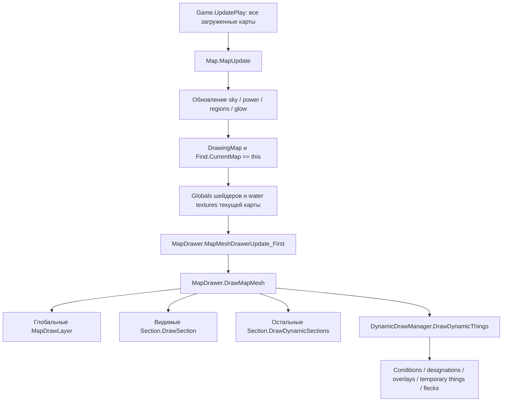

# Рендер RimWorld 1.6.4871

Проверено на локальной Assembly-CSharp, а не на старом публичном декомпиле. Сигнатуры и повторное извлечение: [индекс методов](Engine-method-index.md), `tools/analysis/inspect-engine.ps1`.

## Основной проход

Отрисовка нижнего этажа не запускает `MapUpdate` этой карты как активной. Текстуры воды, параметры освещения и shader globals уже выставлены для верхней карты. Поэтому печать чужого terrain/Thing в свой mesh не эквивалентна полноценному рендеру той карты. Это особенно важно для воды, снега, pollution, теней и материалов других модов.

## Статическая геометрия

Карта делится на секции **17×17**; последняя секция обрезается по границам карты. `Section.CellRect` описывает базовые клетки, `Section.Bounds` учитывает содержимое слоёв. Отбирать только по координатам секций камеры недостаточно для graphics, выходящих за базовую область.

`MapMeshDirty` ставит dirty flags, не строит mesh немедленно. В центральном overload флаги ставятся и в глобальных слоях; дополнительные аргументы определяют соседние клетки и секции. `Section.TryUpdate` сопоставляет dirty flags с `layer.relevantChangeTypes`. Видимые секции могут регенерироваться в текущем кадре; отложенное состояние учитывает `anyLayerDirty`. Ваниль тоже допускает регенерацию в DrawSection — задача мода состоит в ограничении дополнительной работы и сохранении кешей.

`MapDrawLayer.GetSubMesh(material)` переиспользует зарегистрированный submesh. `ClearSubMeshes(parts)` очищает соответствующие **списки данных**, но не удаляет submesh и не уничтожает Mesh. `FinalizeMesh(parts)` загружает данные в Unity Mesh. `RefreshSubMeshBounds()` обновляет bounds для culling. `Dispose()` уничтожает зарегистрированные Mesh и очищает список.

В `SectionLayer_Snow` геометрия 9 вершин на клетку строится один раз, затем обновляются только цвета. `GenerateColorMeshes` должен выдавать столько цветов, сколько уже есть вершин. Для отдельного mesh нужно гарантировать регистрацию, создание геометрии, очистку нужных частей, финализацию, disabled-state и освобождение — все пять шагов.

## Автоматическое обнаружение слоёв

Конструктор `Section` перечисляет `AllSubclassesNonAbstract<SectionLayer>`, создаёт экземпляры и добавляет динамические слои в отдельный список. Поэтому класс-наследник нельзя считать обычной вспомогательной обёрткой. Существование публичного конструктора `(Section)` — часть контракта движка. Удаление «невызываемого» такого класса по статическому графу было бы ошибкой.

## Динамические объекты и пешки

`DynamicDrawManager.DrawDynamicThings()` использует culling, отдельную инициализацию graphics, подготовку видимых вещей и `DynamicDrawPhase`. У пешек есть `PawnRenderer` и `PawnRenderTree`, материалы и части тела. Прямой `RenderPawnAt` — частичный путь, который нужно отдельно проверить на одежде, животных, мехах, эффектах и смене карты.

Призрачная пешка должна одновременно удовлетворять: принадлежность сайту, реальная глубина, незатуманенная исходная клетка, открытая цепочка этажей, clipping и безопасный жизненный цикл render tree. Нельзя менять глобальные материалы обычной пешки, иначе эффект попадёт в её нормальную отрисовку.

## Очереди, высоты и материалы Unity

`Graphics.DrawMesh` ставит геометрию в очередь на кадр. Порядок строк C# не является надёжным порядком итогового изображения. Влияние оказывают renderQueue, shader, depth testing/writing, blending, положение и камера.

В моде neutral/transparent material имеет queue 2998, TintMaterial — 3150. Но прозрачный материал с alpha=0 не гарантирует отсутствие записи глубины: это свойство shader. Необходимо проверить реальные shaders и кадр.

Unity прямо предупреждает, что менять один Material между DrawMesh-вызовами недостаточно для отдельных свойств каждого draw; для этого есть `MaterialPropertyBlock`. Это подтверждает риск общего TintMaterial. PropertyBlock годится только если соответствующий shader использует передаваемое свойство. [Документация Unity 2022.3](https://docs.unity3d.com/2022.3/Documentation/ScriptReference/Graphics.DrawMesh.html).

## Безопасная точка интеграции

Предпочтительный эксперимент: один managed overlay renderer рисует только свою подложку, затем ванильный `DrawMapMesh` выполняется целиком. Призраки получают отдельный hook и отдельную проверку глубины. Если требуются изменения ванильных layers, исследовать узкий patch; Harmony рекомендует не пропускать весь оригинал ради небольшого дополнения. [Harmony Prefix](https://harmony.pardeike.net/v2/articles/patching-prefix.html).

Проверить этот эксперимент нужно с Odyssey gravship, глобальными слоями, нестандартными размерами карт, растянутыми graphics и другими rendering patches. Не переносить патч в main лишь на основании схемы.
