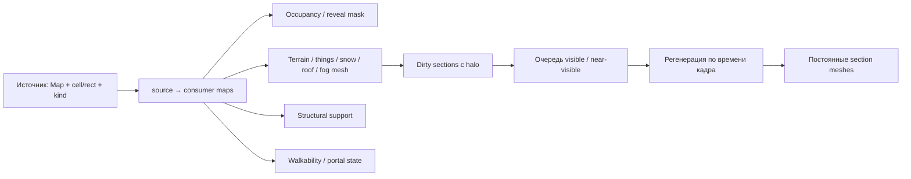

# Порядок исправлений

Этот документ — план следующих изменений. Очистка и анализ уже выполнены; перечисленные изменения рабочего рендера ещё не реализованы.

## P0: восстановить корректность и владение

1. Сохранить оригинальный `DrawMapMesh`, убрать ручную повторную отрисовку ванильных секций. Overlay рисовать своим проходом; отдельно проверить global layers и Odyssey gravship.
2. Выбрать одного владельца lower-layer. Воркеры/mesh живут до удаления карты или смены topology; скрытие за камерой не удаляет их. В Reset/Deinit/смене игры вызывать Dispose и очищать собственные словари флагов.
3. Исправить создание color-submesh: постоянный ресурс на слой, reuse цветов, disabled-state при отсутствии данных. Не добавлять новый snow/sand mesh в список при каждой регенерации. Невидимые ресурсы также принадлежат владельцу.
4. Единственная политика видимости: fog источника, opaque roof, цепочка void, реальные source level и mask footprint. Пешки используют те же правила. Частичное отверстие под большим объектом должно иметь заранее выбранное правило clipping.

Критерий: vanilla draw выполняется ровно один раз; после прогрева прогулка камеры не создаёт новые ресурсы для прежних секций; невидимое содержимое не раскрывается; загрузка другой игры освобождает старые maps/meshes.

## P1: разделить виды инвалидации

| Изменение | Что обновлять | Что не следует делать автоматически |
|---|---|---|
| Terrain / его цвет | Visual mesh; occupancy только при изменении void/solid; halo для transitions | Полностью перестраивать каждый этаж сайта |
| Spawn/despawn building, blueprint/frame | Occupancy footprint, support, visual, соседние секции по bounds | Инвалидировать весь сайт для любой вещи |
| Item/plant, перемещение статически печатаемой вещи | Visual источника, прежний и новый footprint | Пересобирать structural support без структурного изменения |
| Snow/sand/pollution | Color/material/thing visibility и halo | Игнорировать событие только потому, что это не terrain replacement |
| Roof/fog | Видимость, sampled source и consumer meshes | Обновлять только кеш изменённой нижней карты |
| Pawn move | Dynamic ghost list/culling | Перегенерировать terrain mesh |
| Добавлен/удалён этаж, портал, load | Topology/context и dependents | Оставлять контекст с прежними Map references |

Перехватывать центральный overload MapMeshDirty ровно один раз; читать именованные flags и учитывать соседние аргументы. Для semantic occupancy предпочтительнее конкретные события terrain/thing footprint. `MapMeshDirty` — сигнал обновления картинки, а не универсальная семантическая транзакция.

На source map нужно иметь reverse dependencies всех верхних consumers, включая рекурсивные void chains. Инвалидация с `cell/rect + halo` маршрутизируется на этих consumers. Создание карты и WholeMapChanged используют отдельный полный invalidation, без вызова MapMeshDirty по каждой клетке.

Для masks: persistent bitsets, dirty cells/rects, счётчик reveal-клеток на секцию. При multi-cell building нельзя просто обнулить бит после despawn: в клетке может остаться другой occluder. Либо пересчитать эту клетку из thingGrid, либо хранить корректные occupancy counts.

Не вводить throttle, который бесконечно оставляет неверную occupancy. Можно немедленно обновить дешёвую маску, а дорогой mesh поставить в очередь. Отдельно определить допустимый временный fallback для секции без готовой подложки.

## P2: убрать постоянную CPU-работу

- Прямой индекс MapParent→(site,floor) вместо линейного поиска сайта. `GetLevel` не должен строить коллекцию lower floors. Полный render context кэшировать по topology revision и invalidation lifecycle.
- Кешировать доступ к закрытым полям через проверенные FieldRef либо Harmony field injection. Провал привязки должен явно отключать функцию/выдавать одну ошибку, а не молча подставлять уровень 0.
- Проверять verbose flag **до** interpolation и LabelShortCap.
- Перестать строить UpperLevelTerrainGrid в render path, если он там не используется. Сначала проверить остальные публичные consumers.
- Запечь neutral base в секционный mesh; аналогично ограничить overlay опор по видимым секциям.
- Не сортировать этажи и не создавать nextKeys/Keys.ToList на каждом кадре, когда topology/camera section rect не изменились.

Бюджет регенерации задавать миллисекундами, дополнительно ограничивая число секций. «1–2 секции» — стартовый эксперимент, а не универсальная норма: дорогие материалы и печать зданий меняют стоимость. Видимые dirty секции имеют приоритет; offscreen jobs могут ждать.

## P3: визуальная глубина и пешки

Реальную глубину брать из `LowerLevelCellSample.SourceMap/SourceLevel`; соседние клетки могут иметь разные источники. Включить выбранный fade/haze для каждого источника и проверить shader alpha. PropertyBlock или ограниченный cache материалов разделяет состояния draw; общий mutable material не подходит.

Ограничение числа призраков должно быть предсказуемым: приоритет видимых/близких, стабильный порядок и явный fallback. Сначала проверить поддержку pawn render tree текущей игры, затем поддержку сторонних pawn graphics. Простое вычисление tint без его применения не считается реализацией.

## Что не делать первым

Не заменять целиком vanilla renderer, не объединять maps ради 3D pathfinding и не оптимизировать на глаз только одну LINQ-строку. Сначала нужны визуальный эталон, lifecycle и измерения. После каждого этапа повторять только относящиеся к нему сценарии [проверки](Profiling-and-tests.md).
