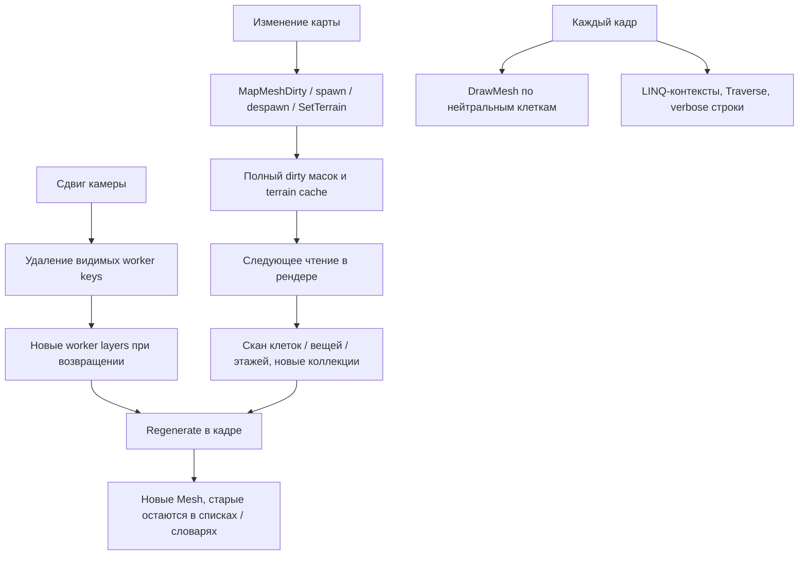

# Почему рендер работал плохо

Это статический аудит с проверкой контрактов установленной игры. «Подтверждено» означает наличие операции или нарушения контракта в коде. Это не означает, что измерена её доля во времени кадра.

## Проверка восьми пунктов Клода

| Пункт | Вердикт | Уточнение |
|---|---|---|
| Нейтральная база по клеткам каждый кадр | Подтверждён | Один `Graphics.DrawMesh` на каждую подходящую клетку, а не на секцию. 100×60 — верхняя оценка 6000 **вызовов API**, если все клетки проходят условие; фактическое число GPU draw calls зависит от Unity и материалов. |
| Каскад инвалидации | Подтверждён с поправками | Любой пойманный вызов сбрасывает оба кеша. Пересборка происходит лениво при следующем чтении, поэтому последовательные invalidations могут объединиться. Бесконечной рекурсии в показанной цепочке нет. Не все ванильные события проходят через перехваченный overload. |
| LINQ, рефлексия и строки в горячем пути | Подтверждён | `GetLevel` создаёт полный контекст; `TryGetFloor` имеет индекс по MapParent, затем линейно ищет сайт. Строки логов создаются до проверки verbose. Долю этих затрат нужно измерить. |
| Воркеры выбрасываются при прокрутке | Подтверждён | `RebuildWorkers` оставляет только видимые ключи. Возвращение камеры вызывает создание слоя и синхронную регенерацию. Вместо ручного уничтожения всех mesh лучше вызвать уже существующий `MapDrawLayer.Dispose()` и освободить собственные дополнительные ресурсы. |
| Утечки submesh | Подтверждено нарушение владения | `GetColorSubMesh` создаёт три Mesh при регенерации. Видимые submesh добавляются в список, который `ClearSubMeshes` **не удаляет**. Невидимые новые ресурсы не регистрируются для Dispose. Словари флагов удерживают submesh; фактический рост памяти нужен из профайлера. |
| Не работает затухание | Подтверждён | `shouldBlur` всегда false. Цвет TintMaterial меняется, но blur-подмеш не рисуется. Затухание и blur — разные эффекты; текущий код вообще не реализует пространственное размытие. |
| Пешки не тонируются | Подтверждён | Результат `PawnTintForDepth` выброшен; используется обычный `RenderPawnAt`. Передать PropertyBlock в `Graphics.DrawMesh` полезно для собственного слоя, но не является готовой интеграцией со всем PawnRenderTree. |
| Верх не узнаёт об изменениях низа | Частично подтверждён | Прямой postfix ищет state только по ID изменённой карты. Однако `SetTerrain`, spawn/despawn и `MarkSiteDirty` уже распространяют некоторые изменения на сайт. Проблема — неполное покрытие событий и соседних секций, а не полное отсутствие propagation. |

Доказательства в исходном снимке: [перехват, нейтральная база и регенерация](https://github.com/Gerbesh/DeepRim.Vertical/blob/62e4dd763e5ae53029776882cdafcbbd75ef833c/Source/VerticalRendering/VerticalSectionRenderPatches.cs#L27), [воркеры](https://github.com/Gerbesh/DeepRim.Vertical/blob/62e4dd763e5ae53029776882cdafcbbd75ef833c/Source/VerticalRendering/VerticalSectionRenderState.cs#L24), [генерация submesh](https://github.com/Gerbesh/DeepRim.Vertical/blob/62e4dd763e5ae53029776882cdafcbbd75ef833c/Source/VerticalRendering/SectionLayer_LowerLevel.cs#L42), [статические словари и TintMaterial](https://github.com/Gerbesh/DeepRim.Vertical/blob/62e4dd763e5ae53029776882cdafcbbd75ef833c/Source/VerticalRendering/VerticalSectionLayerUtility.cs#L33), [пешки](https://github.com/Gerbesh/DeepRim.Vertical/blob/62e4dd763e5ae53029776882cdafcbbd75ef833c/Source/VerticalOverlay/VerticalGhostRenderer.cs#L97).

## Более серьёзные ошибки, обнаруженные дополнительно

### R01. Урезан контракт MapDrawer.DrawMapMesh

Prefix возвращает false, затем `RenderMap` рисует только выбранные секции. В исследованной игре оригинал также обрабатывает глобальные `MapDrawLayer`: проверяет Dirty, регенерирует, обновляет bounds и рисует. Кроме того, расширяет view при `GravshipRenderInProgess`. Эти части в копии отсутствуют.

`Section.DrawSection()` уже рисует все свои layers, включая dynamic. Ваниль вызывает `DrawDynamicSections(view)` для **остальных** секций. Мод вызывает оба метода для видимых секций и не обходит остальные. Возможны повторная отрисовка динамического слоя и потеря содержимого с расширенными границами за исходным section rect. Фактическая повторная отрисовка зависит от `ShouldDrawDynamic` конкретного слоя.

**Что менять:** добавлять подложку в отдельном hook или слое, сохраняя выполнение оригинала. Сначала подтвердить очереди материалов, высоты и активную камеру. Простое `return true` без удаления ручной отрисовки секций даст двойной проход.

### R02. Перехвачена не центральная точка инвалидации

У MapDrawer есть overload с двумя аргументами и overload с четырьмя: `loc, dirtyFlags, regenAdjacentCells, regenAdjacentSections`. Первый делегирует второму. Мод перехватывает только первый. `TerrainGrid.DoTerrainChangedEffects` и `SnowGrid.SetDepth` вызывают второй напрямую. TerrainGrid.SetTerrain дополнительно перехвачен модом, но изменение цвета terrain и изменения снега этим не закрываются полностью.

В `MarkSiteCellsDirty` используется `1UL`. `MapMeshFlagDef` получает mask из индекса Def через `PostSetIndices`. Число нельзя трактовать как универсальный terrain/building flag: нужны именованные `MapMeshFlagDefOf` и минимальный набор для конкретного события.

При обновлении вершины terrain читаются соседние клетки. `MarkDirty(loc)` помечает только одну секцию; изменение на границе требует соседних секций. Крыша меняет выбор источника в sampler, fog — доступность видимого содержания. Фильтр «только terrain/buildings/roofs» без отдельного пути snow/sand/pollution/fog даст устаревшую картинку.

### R03. Слой создаётся двумя независимыми путями

`Section` автоматически создаёт каждый неабстрактный наследник `SectionLayer` через конструктор `(Section)`. `SectionLayer_LowerLevel` подпадает под это правило, а мод дополнительно создаёт собственные экземпляры в `LowerLevelSectionWorker`. Ванильные экземпляры не получают `Prepare`, их `Regenerate` возвращает раньше; это лишние экземпляры и два владельца одной концепции.

Нужен один явный способ интеграции. Если слой управляется вручную, нельзя считать его автоматически управляемым ванильным слоем: бюджет, Dirty, bounds и Dispose остаются обязанностью мода.

### R04. Кеши охватывают намного больше данных, чем использует проход

`DrawSelectiveLowerUnderlay` вызывает `UpperLevelTerrainGrid.GetFor(map)`, что при dirty сканирует все положительные этажи сайта. Но `RebuildWorkers` игнорирует `terrainGrid`, а `Prepare` также игнорирует его. В этом пути дорогой кеш построен без полезного потребителя. Другие публичные методы кеша нужно проверить отдельно перед удалением.

`UpperOverlayVisibilityMask` создаёт два BitArray, проходит terrain, все things и ещё раз terrain. Dirty создаётся даже для карт, которые не нуждаются в верхнем overlay. В `Supports` есть дополнительный проход по всем buildable cells, а затем отдельный RenderCell для видимых клеток.

### R05. Off не является базовым замером

`VerticalGhostRenderer` проверяет enum только для пешек/опор. `DrawSelectiveLowerUnderlay`, нейтральная база и перехват MapDrawer зависят от `enableUpperFloorOverlay`, а не от Off. Значит переключение `Full → Off` измеряет преимущественно стоимость дополнительных призраков. Для отключения основной подложки нужен checkbox `enableUpperFloorOverlay=false`. Даже он не выключает сами postfix-инвалидации.

Документ говорит, что default — Supports, но в `VerticalModSettings` default и ResetDefaults устанавливают Full. [Настройки исходного снимка](https://github.com/Gerbesh/DeepRim.Vertical/blob/62e4dd763e5ae53029776882cdafcbbd75ef833c/Source/Settings/VerticalModSettings.cs#L25).

### R06. Отсутствует единая политика видимости

Sampler проверяет только `RoofConstructed`, а не все типы непрозрачной крыши. Он не проверяет fog источника перед возвратом terrain. `CanSeePawn` проверяет цепочку upper void, но не fog карты пешки. Это подтверждённые отсутствующие проверки; раскрытие конкретного скрытого объекта требует игрового сценария.

`thing.Print(this)` печатает целый объект при проверке клетки его origin. Для многоклеточного или большого graphic это не обеспечивает отсечение по маске отверстий. Кроме того, `PawnRenderAt` самостоятельно не воспроизводит фазы и culling `DynamicDrawManager` текущей игры.

### R07. Глубина реального источника теряется

Воркеры строятся для ближайшего нижнего этажа, но sampler может провалиться через несколько UpperVoid-карт. Параметры `distanceFromActive/alpha` остаются от ближайшего этажа; `sample.SourceLevel` не используется. Даже после включения tint нужно брать глубину каждого результата, иначе `+3 → 0` выглядит как `+3 → +2`.

### R08. Нет полного освобождения при смене игры и карты

RenderState.Reset удаляет ссылку без Dispose. Статические кеши масок и terrain хранят Map и не имеют Remove/ClearAll. WorldComponent.FinalizeInit перестраивает свои индексы, но не очищает эти рендер-кеши. Возможны удержание старых карт и неправильное использование состояния при совпадении uniqueID в новой игре. Ванильный `MapDrawer.Dispose()` освобождает свои зарегистрированные layers; он не владеет внешними worker layers.

## Причинная цепочка

Статическая оценка стоимости: нейтральная база O(видимых клеток) каждый кадр, mask rebuild O(клеток карты + occupied cells вещей), terrain cache rebuild O(суммы клеток положительных этажей). Конкретное узкое место определяется профилированием.
